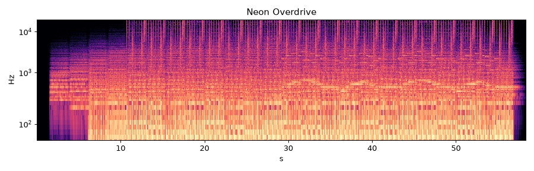

# Neon Overdrive

* **Style:** Synthwave / retro EDM
* **File:** `2026-10-21-p1-synthwave-neon-overdrive.mp3` (58.4 s, peak -1.06 dBFS, RMS -15.8 dBFS, 1.4 MB)
* **Method (short):** Pure numpy/scipy DSP synthesis: PolyBLEP saw/square oscillators, supersaw, FM lead, noise drums, sidechain, convolution reverb
* **Script:** see `2026-10-21-scripts/` (`piece1_*.py`)

## How it was made
Everything is computed sample-by-sample in numpy: anti-aliased PolyBLEP saw/square oscillators, a 7-voice detuned supersaw pad through a time-varying state-variable low-pass (filter opens over the intro), octave-bouncing 8th-note bass, a 16th-note square arpeggio with ping-pong delay, and a 2-operator FM lead with delayed vibrato. Kick = pitch-swept sine, snare = band-passed noise + 190 Hz tone, hats = high-passed noise. Kick-triggered sidechain gain ducks pad/bass/arp.

## Why this technique
Synthwave is literally built from these 1980s subtractive/FM synth primitives, so pure DSP is the most honest and controllable technique - no samples needed.

