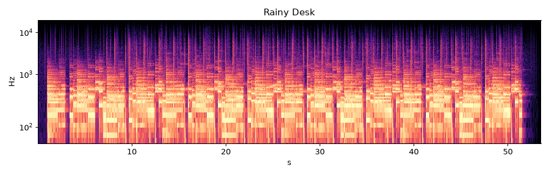

# Rainy Desk

* **Style:** Lo-fi hip hop / jazzy chillhop
* **File:** `2026-10-21-p2-lofi-rainy-desk.mp3` (53.5 s, peak -1.27 dBFS, RMS -12.7 dBFS, 1.29 MB)
* **Method (short):** pretty_midi algorithmic composition (swing, humanisation, Markov melody) -> FluidSynth FluidR3 GM -> numpy lo-fi chain
* **Script:** see `2026-10-21-scripts/` (`piece2_*.py`)

## How it was made
pretty_midi builds the arrangement: Dm9-G13-Cmaj9-A7b9 voicings, rolled chords, 58% swung 16th-note boom-bap with random ghost notes, Gaussian timing/velocity humanisation, and a first-order Markov melody over the C major scale (step-weighted transitions, chord-tone snapping on downbeats). Stems are rendered separately with FluidSynth (FluidR3 GM: EP1, fingered bass, vibraphone, GM drums), then a numpy lo-fi chain adds tape wow (0.5 Hz) + flutter (6 Hz) via modulated delay, tanh saturation, 4.2 kHz low-pass, vinyl crackle and hiss.

## Why this technique
Lo-fi is about jazz harmony + 'imperfect' texture; GM soundfonts sound cheap dry, but the lo-fi chain turns that cheapness into the aesthetic.

