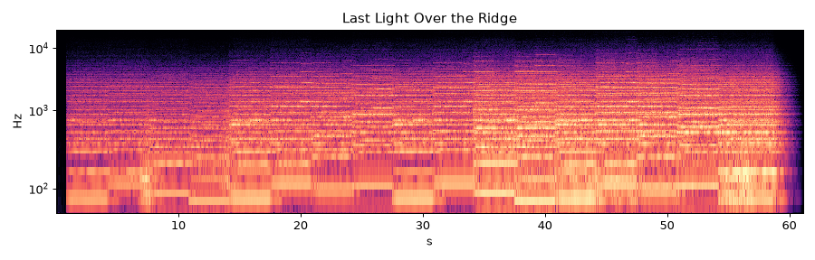

# Last Light Over the Ridge

* **Style:** Orchestral / cinematic trailer
* **File:** `2026-10-21-p3-cinematic-last-light.mp3` (61.1 s, peak -1.26 dBFS, RMS -14.2 dBFS, 1.47 MB)
* **Method (short):** music21 Roman-numeral harmony + greedy voice leading + rule-based theme -> pretty_midi -> FluidSynth GM orchestra -> convolution hall reverb
* **Script:** see `2026-10-21-scripts/` (`piece3_*.py`)

## How it was made
Harmony comes from music21 Roman numerals in D minor (i-VI-III-VII | i-VI-iv-V); a greedy voice-leading function picks the closest 4-voice string voicing for each chord. A rule-based horn theme uses chord tones; spiccato/pizz 8th-note ostinato enters in act 2; act 3 adds choir, brass and timpani hits; ends on a tutti Dm chord with a timpani crescendo roll. Seven FluidSynth stems summed into a 3.2 s convolution hall reverb.

## Why this technique
Orchestral writing is a symbolic-music problem (harmony, voice leading, orchestration), so a music-theory library + soundfont is the right tool; DSP synthesis of strings would be far worse.

