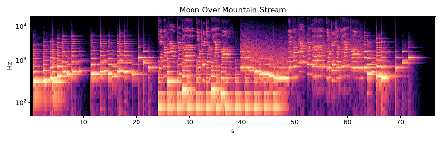

# Moon Over Mountain Stream (月照山河)

* **Style:** Chinese pentatonic, guqin & xiao inspired, Mandarin synthesized vocal
* **File:** `2026-10-21-p4-guqin-vocal-moon-over-stream.mp3` (76.7 s, peak -1.25 dBFS, RMS -13.8 dBFS, 1.84 MB)
* **Method (short):** Additive guqin model with pitch-slide curves + noise-excited xiao (numpy DSP); Markov pentatonic melody; eSpeak-NG cmn singing
* **Script:** see `2026-10-21-scripts/` (`piece4_*.py`)

## How it was made
Guqin is an additive physical-ish model: 14 slightly inharmonic partials with frequency-dependent decay, driven by continuous pitch curves so notes can slide (上/下 glissando) and waver (吟猱 vibrato), plus nail-noise and a body band-pass. Harmonic 'fanyin' tones are bell-like sines. The xiao flute is sine + weak harmonics + band-passed breath noise with delayed vibrato. Melodies are a Markov chain over the D gong-mode pentatonic scale with phrase endings forced to D/A. The Mandarin line 月光照山河，流水向远方 is sung by eSpeak-NG (cmn, female) through vocal.py, repeated with xiao heterophony an octave up.

## Why this technique
Guqin's identity is in pitch slides after the pluck, which soundfonts can't do; an additive model with an explicit pitch curve can. Mandarin vocal tests the singing pipeline on a tonal language.

**Lyrics:** 月光照山河，流水向远方
