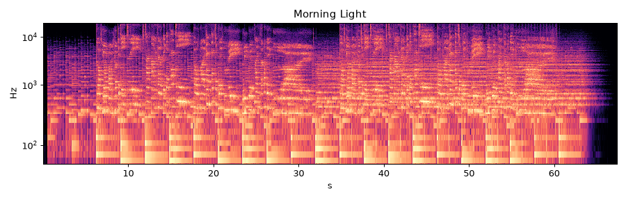

# Morning Light

* **Style:** Pop ballad with synthesized English lead vocal + harmony
* **File:** `2026-10-21-p5-ballad-vocal-morning-light.mp3` (67.4 s, peak -1.02 dBFS, RMS -14.4 dBFS, 1.62 MB)
* **Method (short):** pretty_midi accompaniment -> FluidSynth; eSpeak-NG -> pYIN/pitch-shift/time-stretch 'singing' vocals
* **Script:** see `2026-10-21-scripts/` (`piece5_*.py`)

## How it was made
Piano arpeggios, strings, bass and side-stick drums are pretty_midi -> FluidSynth over I-V-vi-IV. The vocal is 'sung' by eSpeak-NG: each syllable is synthesized with SSML prosody range='x-low' (flattens speech intonation), its median f0 is measured with pYIN, it's pitch-shifted to the melody note, and only the voiced nucleus is time-stretched to the note length (consonants keep their natural length). Vibrato is a modulated fractional delay. Verse 2 adds a diatonic third-above harmony and a double with different eSpeak voice variants, panned, with delay + reverb.

## Why this technique
No open singing-voice model (DiffSinger, NNSVS, etc.) is installed or small enough; this is the best fully-local, CPU-only, sub-1-MB technique to get recognisable sung words.

**Lyrics:** close your eyes the cit tee sleeps / stars are fal ling in the sea / hold my hand and sing with me / we will find the morn ing light
