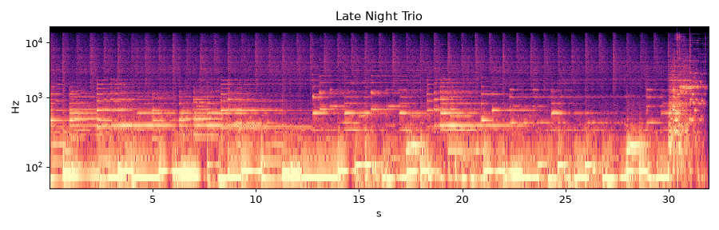

# Late Night Trio (MusicGen)

* **Style:** Smooth jazz piano trio (AI text-to-music)
* **File:** `2026-10-21-p6-ai-musicgen-late-night-trio.mp3` (31.9 s, peak -1.25 dBFS, RMS -13.2 dBFS, 0.77 MB)
* **Method (short):** facebook/musicgen-small (300M, HF transformers, CPU, seed 2026, guidance 3.0, 1600 tokens) + mastering
* **Script:** see `2026-10-21-scripts/` (`piece6_*.py`)

## How it was made
facebook/musicgen-small (Meta, 300M-param autoregressive transformer over EnCodec 32 kHz tokens, T5 text encoder) run via Hugging Face transformers on CPU (8 cores, no GPU). Prompt: 'late night smooth jazz trio, warm upright bass walking line, brushed drums, mellow grand piano chords and melody, intimate club recording, 90 bpm'; seed 2026, classifier-free guidance 3.0, sampling. Output resampled to 44.1 kHz, pseudo-stereo widened, light room, mastered.

## Why this technique
The control experiment: how does an actual generative AI model compare with hand-built agent code? It needs no music theory, only a prompt.

**Prompt:** late night smooth jazz trio, warm upright bass walking line, brushed drums, mellow grand piano chords and melody, intimate club recording, 90 bpm
